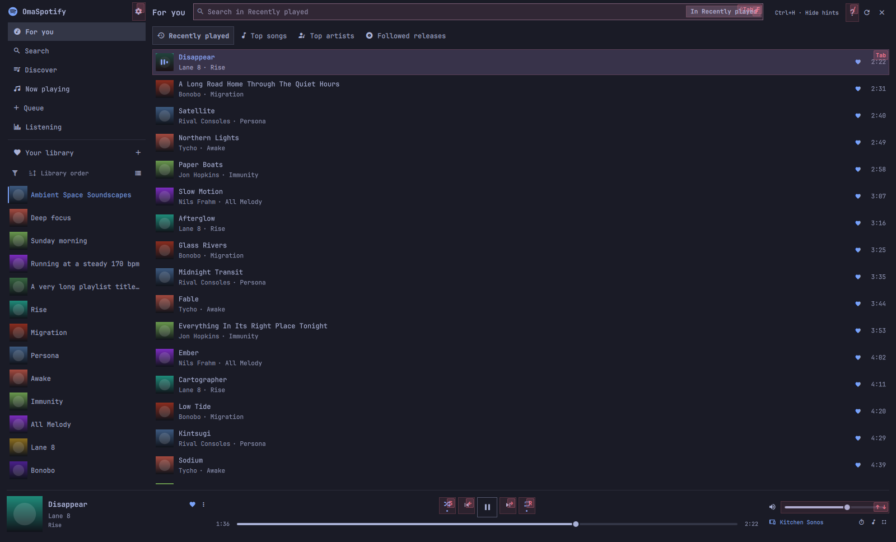
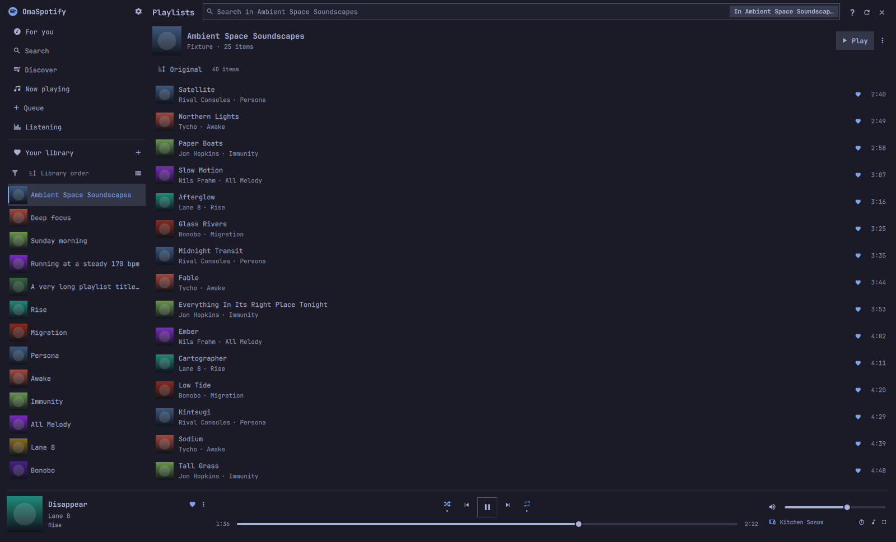
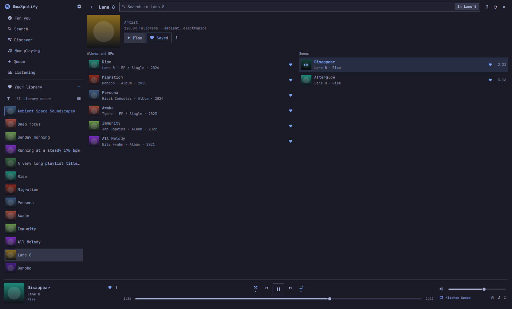
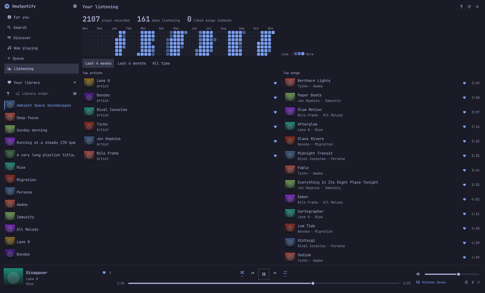
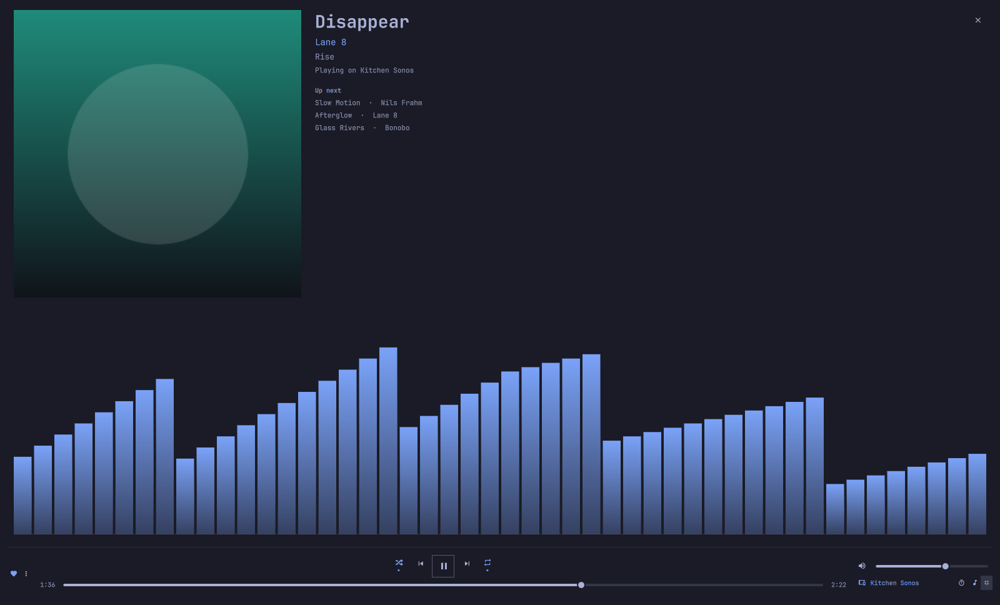
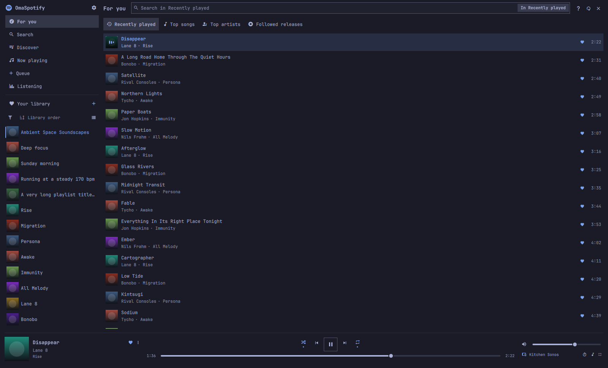
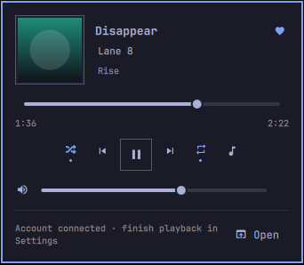

# OmaSpotify

This is [atlastimed’s fork](https://github.com/atlastimed/omaspotify) of
[jeremylanger/omaspotify](https://github.com/jeremylanger/omaspotify), targeting
**Omarchy 4.5** and paired with [Tunemarchy](https://github.com/atlastimed/tunemarchy).
The upstream player and MIT attribution are retained.

Tunemarchy supplies a compact bar panel; this plugin owns the full library,
account sign-in and playback. Hide this plugin’s own bar entry with
`omarchy bar set io.github.atlastimed.omaspotify showBarWidget false --json`.
The full player remains available through Tunemarchy’s **Open** action or
`omarchy-shell shell summon io.github.atlastimed.omaspotify '{}'`.

The companion connection carries public playback state and a fixed list of
controls over a display-scoped Unix socket in your private runtime directory.
It never exposes access or refresh tokens. Queue and device requests happen
when expanded; progress updates stop when the companion closes. The service
is available for the companion without opening a second bar player. Local
audio playback still starts on demand.

This fork uses the upstream runtime name `omaspotify` for its audio service,
configuration and caches. Use one OmaSpotify fork at a time; do not enable
this and the original together. No official Spotify installation is replaced.


A native Qt Quick player that follows your Omarchy theme. The default local
audio engine is [Spotify Soloist](https://developer.spotify.com/documentation/soloist),
with a small Rust adapter for MPRIS and playback commands. The official Spotify
app is needed once for pairing; it can be closed afterwards. This fork has no
new memory benchmark; upstream measurements describe the former librespot setup.

## Install

```bash
omarchy plugin add https://github.com/atlastimed/omaspotify.git --enable
```

Requires Omarchy 4.5, a personal Spotify Premium account, and your own Spotify Developer app.

## Why you will love it

- **Lightweight by design.** Enjoy your music without keeping a browser-sized
  desktop client running.
- **Made for Omarchy.** Every color follows your current theme automatically,
  including light themes.
- **Always within reach.** Play, pause, skip, seek, change volume, or open
  lyrics from the mini player in your bar. Your last song stays loaded, so
  Play picks up where you left off even after the player has gone idle.
- **Your full music library.** Search Spotify, browse artists and albums,
  manage playlists and the queue, and move playback between Spotify Connect
  devices.
- **Lyrics with Omasing.** Open the current song in Omasing and let it find the
  right lyrics and playback position automatically.

## Familiar from the first click

The layout is inspired by the Spotify client, so there is almost nothing new
to learn. Your library and playlists live in the sidebar, search stays at the
top, the player stays at the bottom, and artist and album names take you
straight to their pages.

Prefer to keep your hands on the keyboard? The whole app is designed for that
too.

| Shortcut | What it does |
| --- | --- |
| `Ctrl+F` or `/` | Search all of Spotify |
| `Ctrl+F` or `/` again | Toggle current area / all of Spotify |
| `Tab` / `F6` | Move between sidebar, search, the song list, and the player |
| `Arrow keys` | Move to a control; Enter activates |
| `C` | Row actions; arrows or Enter choose |
| `Space` | Play or pause |
| `Ctrl+Left` / `Ctrl+Right` | Previous or next song |
| `Shift+Left` / `Shift+Right` | Seek 10 seconds |
| `Ctrl+Up` / `Ctrl+Down` | Change volume |
| `M` | Mute or restore volume |
| `Ctrl+Shift+A` | Open the current song's artist |
| `Ctrl+Shift+B` | Open the current song's album |
| `Ctrl+/` | See every keyboard shortcut |
| `Ctrl+H` | Hide visible shortcut hints |

The first shortcut, Tab, or opening the player from the keyboard lights
matching controls with the next key. Hold Ctrl, Shift, or Alt to see those
chords; the matching hints remain until you release the held modifiers. While
hints are visible, the header keeps a **Ctrl+H · Hide hints** action in reach.
It turns hints off until you enable them again in Settings.



The mini-player takes keyboard focus when it is opened from a shortcut. Use
`Tab` or the arrow keys to select every control, `Enter` to activate buttons,
left/right to adjust a selected slider, and `Esc` to close. The playback
shortcuts above work there too; `Ctrl+S` toggles shuffle, `Ctrl+R` cycles
repeat, `Ctrl+Shift+L` opens lyrics, `Ctrl+Shift+A` and `Ctrl+Shift+B` open the
current artist or album in the full player, and `O` expands the full player.

## See it in action

### Your playlists, instantly familiar

Everything is where you expect it to be—just faster, lighter, and dressed in
your Omarchy theme. Your whole library lives in the sidebar: playlists,
albums, artists and podcasts together, sorted however you like.



### Everything from an artist, in one view

Followers and genres, top albums and EPs, the artist's ten biggest songs, every
liked song you already have by them, and who else they sit next to—one page, no
digging.



### What you actually listened to

Spotify keeps your last fifty plays and shows you none of it. OmaSpotify keeps
its own record from the day you install it, so the heatmap fills in as you
listen, and top artists and songs sit underneath it across three ranges.



### The song, full size

`E` or `Alt+Shift+N` gives the current track the whole window—artwork, title,
and a live equalizer drawn in your theme's colours. `V` switches between bars,
pixels, scope and matrix. The equalizer listens only to OmaSpotify's own audio
and needs `cava` (`omarchy pkg add cava`).



### Everything you were just listening to

Recently played, your top songs and artists, and new releases from the artists
you follow—each one a tab away.



### A mini player that belongs in your desktop

The essentials are always one click away, without reopening the full app.



### Lyrics, already matched to the song

One click sends the current track to Omasing, where the lyrics are fetched and
lined up with your playback position—ready to auto-scroll as you listen.


## Set it up

To replace Omarchy's existing **Super+Shift+M · Music** binding, add this to
`~/.config/hypr/bindings.lua`:

```lua
  hl.unbind("SUPER + SHIFT + M") -- previously: Music
  o.bind("SUPER + SHIFT + M", "OmaSpotify",
    "omarchy shell -q io.github.atlastimed.omaspotify.player togglePlayer")
```

Run `hyprctl reload` and check `hyprctl configerrors` after saving. Until the
binding is replaced, Omarchy's stock Music binding stays active and the
Settings choice below has no effect on the shortcut.

In OmaSpotify's Settings, choose whether that shortcut launches Omarchy's
Music app, toggles the full player, or toggles the mini-player. Separate
bindings can call `toggleMiniPlayer` or `toggleFullPlayer` on the same
`io.github.atlastimed.omaspotify.player` target.

Raise or lower Spotify volume from a keybinding without opening the player:

```bash
omarchy shell -q io.github.atlastimed.omaspotify.player volumeUp
omarchy shell -q io.github.atlastimed.omaspotify.player volumeDown
```

Each step is 5%, the same as Ctrl+Up / Ctrl+Down. This changes Spotify's own
volume, including speakers, not the computer's output level.

## Connect your Spotify account

1. Click the Spotify icon in your bar (on the left by default; your layout may
   place it elsewhere).
2. Click **Set up and continue**, or **Continue with Spotify** if playback is
   already installed.
3. Sign in on Spotify's own page in your browser and approve access.
4. To listen on this computer, complete the separate playback authorization
   in your browser. If prompted, choose **Finish playback setup**.

You need a Spotify Premium account. You do not need to create a Spotify
Developer app or enter a client ID, client secret, or password in OmaSpotify.
Account access and playback on this computer use separate authorizations.

Local playback installs an exact-version backend only after its GitHub build
provenance matches this plugin version's tag and the checkout's backend inputs
still match that tagged source. If verification is unavailable, setup builds
the locked Rust source locally instead of executing an unverified download.

## Connect your Spotify account

1. Open the [Spotify Developer Dashboard](https://developer.spotify.com/dashboard)
   and create or select your own app with **Web API** enabled.
2. Add `http://127.0.0.1:8989/login` to its Redirect URIs, exactly. Existing
   redirects can remain. Spotify requires an explicit loopback IP, not `localhost`.
3. Paste the app's **Client ID** into OmaSpotify's sign-in page and choose
   **Use this app**. No client secret is needed. You can change it later in Settings.
4. Choose **Continue with Spotify**, authorize your account. Stored account sessions are isolated by client ID.
5. In Settings, choose **Install / repair Soloist**. Create a personal Soloist
   key in Spotify’s dashboard after reviewing its terms, paste it into the
   masked field, and choose **Save key and start pairing**.
6. Open the official Spotify phone or desktop app on the same network. Select
   **OmaSpotify** in its device picker and play a song once. If the phone does
   not discover it, try the desktop client on this computer. You can close
   that client after pairing.

If Spotify reports `redirect_uri: Not matching configuration`, check that the
callback above is saved on the same app whose client ID you entered, then
restart sign-in from OmaSpotify. Reloading an old authorization tab retains
its old app ID and callback.

This fork does not borrow ncspot's app ID or silently use its catalog session.
Spotify restricts some discovery/catalog endpoints and Spotify-owned playlists
for development-mode apps, so those results may be unavailable. Core library
and playback features use your app. See Spotify's
[quota modes](https://developer.spotify.com/documentation/web-api/concepts/quota-modes)
for current account, allowed-user, and usage limits. A personal app is for your
own use; do not distribute your ID as the default for other installations.

### Local playback and updates

Soloist is downloaded directly from Spotify, not redistributed in this repository.
Its builds expire after 90 days. The installed user timer checks daily and renews
builds after 75 days; startup also checks. A running player keeps playing during
an update and uses the new build on its next start. Internet access is required
for renewal. The cache is capped at 512 MB.

The API key is stored in GNOME Keyring, and pairing state lives in the private
`$XDG_STATE_HOME/omaspotify/soloist` directory. Do not paste your key into an issue
or commit it. Soloist currently accepts its key as a process argument, so other
processes running as your Linux user can inspect it. Its control WebSocket binds
only to loopback; local clients, including browser pages, must be trusted.

`omaspotify-soloist.service` starts on demand. The update timer is enabled at login;
the player itself is not. Inspect either with `systemctl --user status`.
The previous librespot engine remains available through the `playbackEngine`
setting for troubleshooting; stop playback before changing engines. It uses a
separate browser authorization and may be affected by Spotify audio-key refusals.

### If playback setup fails

If the verified backend release is unavailable, the fallback build needs
Rust and Cargo. They are not installed by the plugin. On Omarchy, install
Rustup (which supplies Rust and Cargo), then rerun setup from the plugin
directory so Rustup uses the version in `rust-toolchain.toml`:

```bash
omarchy pkg add rustup
cd "$HOME/.config/omarchy/plugins/io.github.atlastimed.omaspotify"
./scripts/setup-soloist.sh
```

If you already have a working Rustup installation, skip the first command.
The first build downloads the toolchain and dependencies and may take several
minutes. After it succeeds, restart the shell with `omarchy restart shell`,
open OmaSpotify, and continue signing in.

**Playback setup could not be completed** is a general setup error, not a
Spotify password error. Running `./scripts/setup-soloist.sh` in a terminal shows the
underlying error. Missing Rust/Cargo is one possible cause; see the
[technical prerequisites](docs/TECHNICAL.md) for the other requirements.

## Remove it completely

Run the bundled uninstaller from outside the plugin directory:

```bash
cd "$HOME" && "$HOME/.config/omarchy/plugins/io.github.atlastimed.omaspotify/scripts/uninstall.sh"
```

It disables and removes the plugin, stops and removes its user service,
restarts the shell, and deletes all plugin-owned configuration, cached audio,
the Soloist update timer, backend build files, installed binaries, playback state, runtime sockets, old
configuration backups, and matching GNOME Keyring entries.

If you prefer to inspect and paste the main steps individually:

```bash
plugin_dir="$HOME/.config/omarchy/plugins/io.github.atlastimed.omaspotify"
cd "$HOME"
omarchy plugin disable io.github.atlastimed.omaspotify 2>/dev/null || true
"$plugin_dir/scripts/remove-runtime.sh" --purge
omarchy plugin remove io.github.atlastimed.omaspotify --yes
omarchy restart shell
```

The cleanup deliberately leaves unrelated software alone. A source checkout
outside Omarchy's plugin directory and separate plugins such as Omasing remain
in place.

Very old installation instructions may also have added a custom Hyprland
shortcut. The uninstaller reports any such references without rewriting your
personal configuration. Check both the live config and, when applicable, its
chezmoi source:

```bash
rg -in 'quickshell\.spotify|omaspotify' \
  "$HOME/.config/hypr" "$HOME/.local/share/chezmoi" 2>/dev/null
```

Remove only the matching custom lines, apply the dotfiles change, and run
`hyprctl reload`. Omarchy's stock **Super+Shift+M** Music shortcut will then be
used again.

## Library features

- Browse discovery results where Spotify makes them available to your developer app.
- Browse Liked Songs, saved albums, followed artists, podcasts, and books.
- Create playlists, add songs, reorder tracks, and turn followed playlists
  into your own editable copies when Spotify makes their contents available.
- Build a queue, start track radio, use shuffle and repeat, or set a sleep timer.
- Listen on this computer or switch to another Spotify Connect speaker or player.
- Choose the mini-player or full player independently for the bar icon and
  keyboard shortcut, use optional spinning vinyl artwork in the mini-player,
  show the title, artist, or both, and softly scroll overflowing text at an
  adjustable speed.
- Soloist manages local streaming quality; the legacy quality setting applies only to librespot.

Your Spotify password is entered only on Spotify's own page. OmaSpotify
stores your saved session in GNOME Keyring and clears it when you log out.

Want the details? Read the [technical notes](docs/TECHNICAL.md) or see the
[memory benchmark](docs/BENCHMARK.md).

OmaSpotify is an independent project and is not affiliated with Spotify.
Spotify is a trademark of Spotify AB.

Licensed under the [MIT License](LICENSE).
